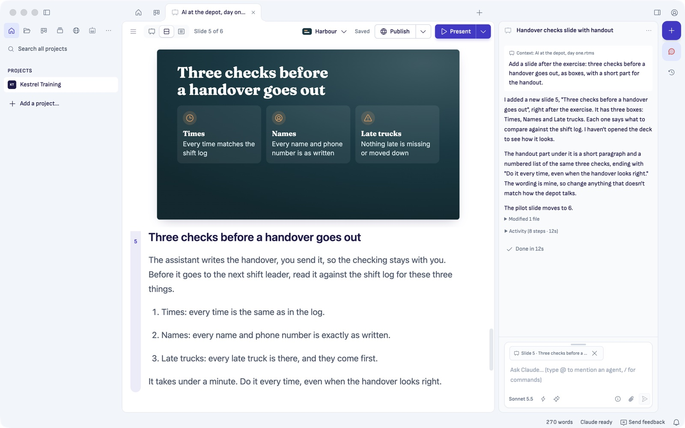
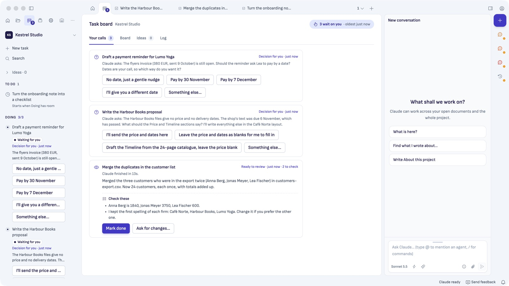

  <a href="https://ritemark.app">
    <picture>
      <source media="(prefers-color-scheme: dark)" srcset="images/readme/ritemark-logo-on-dark.svg">
      
    </picture>
  </a>

<strong>Ritemark turns a folder on your computer into a workspace where ChatGPT or Claude work with you.</strong>

  
  
  

  <a href="https://ritemark.app">Website</a> ·
  <a href="#download">Download</a> ·
  <a href="https://github.com/jarmo-productory/ritemark-public/releases/tag/v2.3.0">What's new in 2.3</a> ·
  <a href="https://github.com/ProductoryHQ/ritemark-native">Source code</a>

This repository holds Ritemark's installers and release notes. The source code is in [ProductoryHQ/ritemark-native](https://github.com/ProductoryHQ/ritemark-native).

## Download

**Latest: Ritemark 2.3.0** (23 November 2026)

| Platform | Download |
| --- | --- |
| Mac with Apple silicon (M1 and later) | [Ritemark-arm64.dmg](https://github.com/jarmo-productory/ritemark-public/releases/download/v2.3.0/Ritemark-arm64.dmg) |
| Mac with Intel | [Ritemark-x64.dmg](https://github.com/jarmo-productory/ritemark-public/releases/download/v2.3.0/Ritemark-x64.dmg) |
| Windows | [Microsoft Store](https://apps.microsoft.com/detail/xp9k8sp24trnk4), or the installer [Ritemark-Setup.exe](https://github.com/jarmo-productory/ritemark-public/releases/download/v2.3.0/Ritemark-Setup.exe) |

Ritemark tells you when a new version is out. A version from the Microsoft Store updates from the Store. Every release and its notes are under [Releases](https://github.com/jarmo-productory/ritemark-public/releases).

## What Ritemark is

Your notes, transcripts, sources and drafts sit in one folder. In Ritemark, ChatGPT or Claude work in that folder with you. The AI starts from your whole folder, not from one chat box: it writes the draft, you check it and send it.

Your documents stay plain Markdown files on your computer, and you need no Ritemark account. Ritemark works with any ChatGPT account, Free included, or a paid Claude plan. It is free and open source, for Mac and Windows.

## New in 2.3: slides

You can now make slides in Ritemark, present them, and give every participant a page to work through. Write a deck as you write a document, with a handout beside the slides. 2.3 also lets you edit Excel files and keep their look, change pictures yourself or with ChatGPT, and change tables with the mouse. [Read the 2.3 release notes](https://github.com/jarmo-productory/ritemark-public/releases/tag/v2.3.0).

<table>
  <tr>
    <td width="50%"></td>
    <td width="50%"></td>
  </tr>
  <tr>
    <td>The Task board: Claude asks before it decides, and you review what comes back.</td>
    <td>A PowerPoint file read in Ritemark, with Claude's answer about it.</td>
  </tr>
</table>

## Help and feedback

- [Getting started](https://github.com/ProductoryHQ/ritemark-native/blob/main/docs/user/getting-started.md) and the [feature guide](https://github.com/ProductoryHQ/ritemark-native/blob/main/docs/user/features/README.md)
- [Report a problem or ask for a feature](https://github.com/ProductoryHQ/ritemark-native/issues)

## License

Ritemark is open source under the [MIT licence](https://github.com/ProductoryHQ/ritemark-native/blob/main/LICENSE). Copyright (c) 2024-2026 Productory Services OÜ. The Ritemark name, logos and brand assets are trademarks of Productory Services OÜ.
